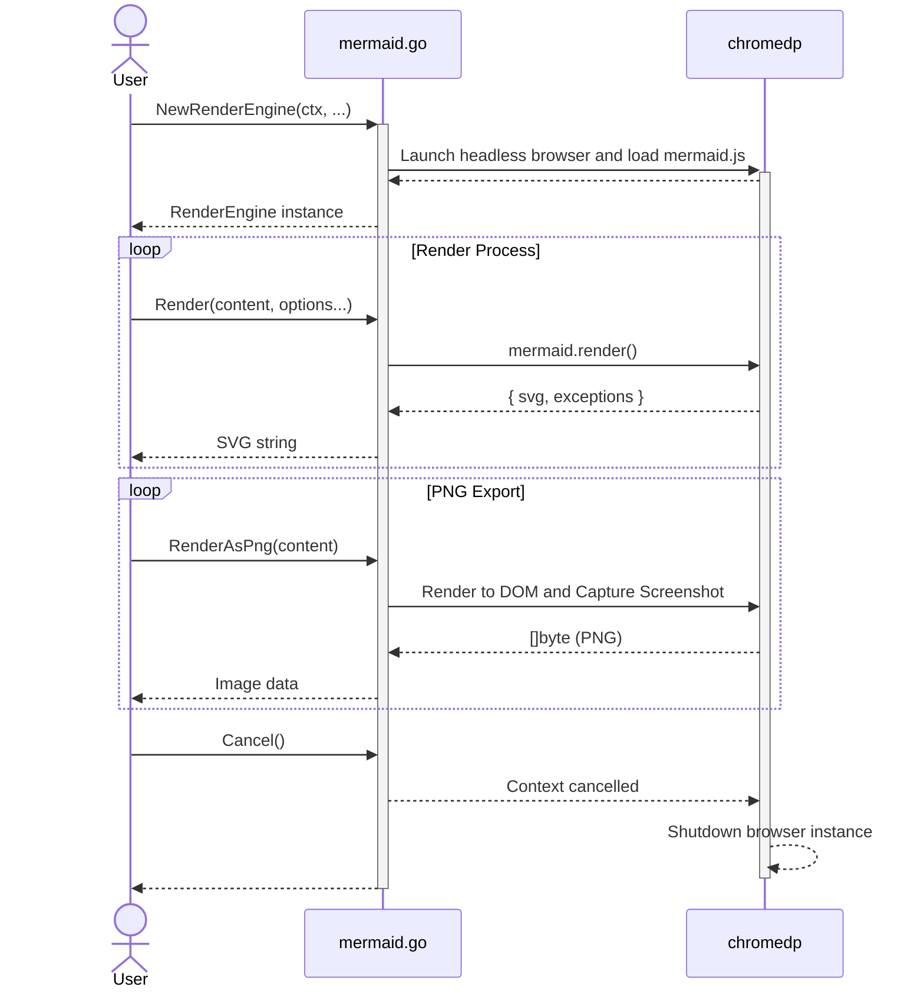

# mermaid.go

[mermaid.go][] is a lightweight Go library that bridges [mermaid.js](https://github.com/mermaid-js/mermaid) and Go, allowing you to generate high-quality diagrams (SVG and PNG) directly from your Go applications.

It works by leveraging [chromedp](https://github.com/chromedp/chromedp) to run a headless Chrome/Chromium instance, providing a robust and accurate rendering environment for all Mermaid diagram types.

For deployments where a browser is unwelcome, two more backends render through [merman][], a native
Rust implementation of Mermaid: one runs its CLI, the other runs its WebAssembly module in process —
see [Rendering without a browser](#rendering-without-a-browser).

## Prerequisites

The default backend uses `chromedp`, so you must have **Google Chrome** or **Chromium** installed on
your system. The merman backends need neither: the CLI backend requires only the `merman-cli` binary
on `PATH`, and the WebAssembly backend only merman's `merman_wasi.wasm` module, which this module
ships — no binary, no cgo.

## Installation

```shell
go get -u github.com/dreampuf/mermaid.go
```

The root package embeds no renderer assets. Each backend that needs one has a subpackage that embeds
it and registers it when imported, so a program links only what it renders with:

| Import | Embeds | Enables |
| --- | --- | --- |
| `_ "github.com/dreampuf/mermaid.go/mermaidjs"` | `mermaid.min.js`, ~5 MB | `NewRenderEngine` (chrome) |
| `_ "github.com/dreampuf/mermaid.go/mermanwasm"` | merman's standard `merman_wasi.wasm`, ~15 MB | `NewMermanWasmEngine` with no module option |

Import either, both, or neither. `NewMermanEngine` needs neither, since it runs the `merman-cli`
binary. For a minimal program that only references the package, the binary is 3.6 MB with neither,
8.9 MB with `mermaidjs`, 19 MB with `mermanwasm`, and 24 MB with both.

Moving the bundle out of the root package is a breaking change for the chrome backend, since earlier
releases embedded `mermaid.min.js` there. Without the `mermaidjs` import, `NewRenderEngine` now fails at
once with `ErrMermaidNotReady`, and its message names the import to add. Assigning your own bundle to
`SourceMermaid` still works, and an assignment made before the subpackage's `init` takes precedence.

## Architecture



## API Overview

### `NewRenderEngine(ctx context.Context, statements []string, options ...chromedp.ExecAllocatorOption) (*RenderEngine, error)`
Initializes a new render engine by launching a headless browser and loading `mermaid.js` from
`SourceMermaid`, which importing `mermaidjs` sets. 
- `statements`: Optional JavaScript statements to execute during initialization (e.g., custom mermaid configuration).
- `options`: Variadic list of `chromedp` allocator options.

If `ctx` has no deadline, loading the bundle and running `statements` is bounded by
`DefaultStartupTimeout` (60s); pass a context with a deadline to choose your own. Bear in mind that `ctx` also governs the **engine's whole lifetime**, so for a long-lived
engine prefer `context.Background()` and let each render carry its own deadline.

### `Render(content string, opts ...RenderOption) (string, error)`
Renders a Mermaid diagram source into an SVG string.
- `WithBundle()`: An option to include the original Mermaid source code within a `<desc>` tag in the generated SVG. SVG only — passing it to a PNG method returns `ErrUnsupportedOption` rather than being silently ignored.
- `WithTimeout(d time.Duration)`: An option to override the render deadline for this call. `d <= 0` disables it.

### `RenderAsPng(content string, opts ...RenderOption) ([]byte, *BoxModel, error)`
Renders a Mermaid diagram source into a PNG image. Returns the raw PNG bytes and the diagram's bounding box dimensions. On failure it returns no image and no box model, so a partial screenshot cannot be mistaken for a complete one.

### `RenderAsScaledPng(content string, scale float64, opts ...RenderOption) ([]byte, *BoxModel, error)`
Renders a Mermaid diagram into a scaled PNG image. Useful for generating high-resolution outputs.

### `RenderContext`, `RenderAsPngContext`, `RenderAsScaledPngContext`
Context-aware equivalents of the three methods above, taking `ctx context.Context` as the first
argument. Use these from a server: the context covers **the wait for other renders as well as the
render itself**, so an abandoned request stops consuming a slot. Renders are serialised on one
browser tab, and the render deadline only starts once a render begins, so without a context the
queueing wait is unbounded no matter how short the timeout.

`ctx`'s deadline applies whenever it is sooner than the engine's render timeout, and its
cancellation is propagated. Only cancellation and the deadline are taken from `ctx` — its values are
not, because the render has to run on chromedp's own context.

```go
svg, err := re.RenderContext(req.Context(), content)
```

### `SetRenderTimeout(d time.Duration)`
Overrides `DefaultRenderTimeout` (30s) for subsequent renders. Every render runs on its own
deadline derived from the engine context, so a page that never settles — or a screenshot that
waits on a node chrome never reports as visible — fails with `context.DeadlineExceeded` instead
of blocking forever. A timed out render does not invalidate the engine; the next one proceeds
normally. Pass `d <= 0` to disable the deadline and rely on the engine context alone.

### `SetTargetCrashedHandler(fn func(error))`
Registers a callback for chrome's `Inspector.targetCrashed` notification (and for a detach with an
unexpected reason, such as `Render process gone.`), so a crashed browser is reported rather than
observed as a timeout. `fn` receives an error wrapping `ErrTargetCrashed`, annotated with chrome's
detach reason when one is supplied. It runs on the engine's event goroutine: it must return promptly
and must not call back into the engine — hand the error to a logger or a buffered channel. A panic
in `fn` is recovered rather than being allowed to take the process down, but it is then discarded,
so do not rely on it surfacing anywhere.
Because chrome reports the crash and its reason as separate events, `fn` may be called more than
once per crash, each time with more detail.

### `SetConsoleHandler(fn func(chromedp.ConsoleMessage))`
Registers a callback for every message the page writes to its console: mermaid's own log, uncaught
exceptions and unhandled promise rejections, and chrome's log entries. Use it to learn why a render
failed or came out wrong. mermaid logs only fatal errors by default, so raise its `logLevel` with a
statement passed to `NewRenderEngine`, such as `mermaid.initialize({logLevel: 'warn'})`, to see
more. Messages written before `fn` is installed, including those from `NewRenderEngine`, are
dropped. Like the crash handler, `fn` runs on the engine's event goroutine, one message at a time
and in order: it must return promptly and must not call back into the engine, and a panic in it is
recovered and discarded. A render abandoned on a timeout keeps running in the page, so a message
is not reliably tied to the render in flight when it arrives. Pass `nil` to remove the handler.

### `CrashError() error`
Returns the recorded crash error, or `nil` if the target is healthy. Renders that fail while the
target is crashed return the underlying chromedp error joined with this one, so
`errors.Is(err, ErrTargetCrashed)` distinguishes a dead browser from a slow diagram. The state
clears if chrome reloads the target after the crash.

### `Cancel()`
Closes the underlying browser instance and releases all associated resources. It does not wait for
an in-flight render: it aborts one, rather than queueing behind it. Every subsequent render fails
with `ErrEngineClosed`.

## Errors

Failures are classified with sentinel errors so callers can branch with `errors.Is` instead of
matching on messages — which matters mainly for deciding whether a retry is worthwhile:

| Error | Meaning | Retry? |
| --- | --- | --- |
| `ErrRenderException` | The backend rejected the diagram source. Both backends use it, and each leaves its own detail reachable via `errors.As`: Chrome a `*chromedp.ExceptionError`, which embeds the `*runtime.ExceptionDetails` (it raises a genuine JavaScript exception, with the script location and stack), the merman CLI a `*MermanExitError`, the merman WebAssembly module a `*MermanWasmError`. | No — it will fail identically |
| `ErrTargetCrashed` | Chrome died. Joined to the underlying error, and reported to `SetTargetCrashedHandler`. | Yes, on a fresh engine |
| `context.DeadlineExceeded` | The render, or the wait for a turn, outran its deadline. | Maybe |
| `ErrUnsupportedOption` | A `RenderOption` the called method cannot honour, e.g. `WithBundle()` on a PNG. | No — fix the call |
| `ErrFailedEncoding` | The diagram source could not be JSON-encoded. Wraps the underlying error. | No |
| `ErrMermaidNotReady` | `mermaid.js` did not initialise. The message names what `typeof mermaid` actually was. | No |
| `ErrEngineClosed` | The engine's context is done, because `Cancel()` was called, the context passed to `NewRenderEngine` was cancelled, or the browser process died — in which case the error also wraps its `*exec.ExitError`. Without it this is indistinguishable from a cancelled caller, yet it needs the opposite response. | No — build a new engine |

The merman backends report the same `ErrRenderException`, `ErrUnsupportedOption`,
`ErrEngineClosed` and `context.DeadlineExceeded`, plus three of their own:

| Error | Meaning | Retry? |
| --- | --- | --- |
| `ErrMermanUnavailable` | The `merman-cli` binary was not found or could not answer the capability probe; or the WebAssembly module was missing, would not compile, or is not a merman-wasi ABI 1 reactor. Only the constructors return it. | No — fix the installation |
| `ErrMermanCapability` | The binary or module was built without a feature the call needs, e.g. PNG output. | No — install a different build |
| `ErrMermanFailed` | merman failed for a reason other than an invalid diagram: a rejected command line or options, an unusable configuration, an operational failure or a WebAssembly trap, or unusable output. Carries merman's diagnostics. | Maybe |

`errors.As` recovers a `*MermanExitError` (`Bin`, `Code`, `Stderr`) whenever a merman process is what
failed. It is worth reaching for, because the exit codes do not partition failures perfectly on every
release: 0.7.0 exits 1 for a missing or malformed configuration file as well as for an invalid
diagram, and only the status and the diagnostics tell those apart. 0.8 fixed that — configuration
errors moved to exit 2 — but the status stays exposed rather than assumed. `NewMermanEngine` reads the file
given to `WithMermanConfigFile` up front for exactly that reason — so the mistake it *can* catch
fails once, honestly, instead of making every render look like a bad diagram. A file smuggled in
through `WithMermanArgs` is still merman's to reject.

The WebAssembly backend has no such ambiguity: merman reports each failure as a structured payload,
recovered with `errors.As` as a `*MermanWasmError` (`Code`, `CodeName` such as `MERMAN_PARSE_ERROR`,
`Kind`, `CapabilityID`, `Message`, and the raw `Details` JSON, which carries a parse error's source
span). Parse, render, no-diagram, UTF-8 and resource-limit failures are `ErrRenderException`; a
missing capability is `ErrMermanCapability`; everything else is `ErrMermanFailed`.

## Example

```go
package main

import (
	"context"
	"log"
	"os"

	"github.com/chromedp/chromedp"
	"github.com/dreampuf/mermaid.go"
	_ "github.com/dreampuf/mermaid.go/mermaidjs"
)

func main() {
	ctx := context.Background()
	// Initialize the engine
	re, err := mermaid_go.NewRenderEngine(ctx, nil)
	if err != nil {
		panic(err)
	}
	defer re.Cancel()

	// Learn why a render failed when the browser itself went away
	re.SetTargetCrashedHandler(func(err error) {
		log.Printf("mermaid render engine unusable: %v", err)
	})

	// See what mermaid and the page write to the console
	re.SetConsoleHandler(func(m chromedp.ConsoleMessage) {
		log.Printf("mermaid console: %v", m)
	})

	content := "graph TD; A-->B;"

	// Render as SVG with the original source bundled
	svg, err := re.Render(content, mermaid_go.WithBundle())
	if err != nil {
		panic(err)
	}
	os.WriteFile("diagram.svg", []byte(svg), 0644)

	// Render as high-res PNG
	png, _, err := re.RenderAsScaledPng(content, 2.0)
	if err != nil {
		panic(err)
	}
	os.WriteFile("diagram.png", png, 0644)
}
```

## Rendering without a browser

[merman][] is a native (Rust) implementation of Mermaid that parses, lays out and renders diagrams
without a browser or a JavaScript runtime. This package can run it two ways:

- `NewMermanEngine` drives its **CLI**. An engine costs one capability probe to start instead of a
  Chrome launch, and a deployment needs only the `merman-cli` binary.
- `NewMermanWasmEngine` runs its **WebAssembly module** in process, on the pure Go
  [wazero](https://wazero.io) runtime. There is no external process at all and no cgo, so it works
  wherever Go does; importing `mermanwasm` embeds the module in the program. See
  [In process, through WebAssembly](#in-process-through-webassembly).

Bear in mind that merman is a *reimplementation* of Mermaid, not Mermaid itself: it targets a pinned
Mermaid baseline (`MermaidVersion()` reports which) and its SVG is not byte-identical to the browser
backend's. `NewRenderEngine` remains the reference implementation.

```go
re, err := mermaid_go.NewMermanEngine(context.Background())
if err != nil {
    panic(err) // e.g. errors.Is(err, mermaid_go.ErrMermanUnavailable): merman-cli is not installed
}
defer re.Cancel()

svg, err := re.Render("graph TD; A-->B;", mermaid_go.WithBundle())
```

Both engines satisfy the `Renderer` interface — `Render`, `RenderAsPng`, `RenderAsScaledPng`, their
`Context` variants, `SetRenderTimeout` and `Cancel` — so a program can choose a backend at startup
and pass the result around:

```go
var re mermaid_go.Renderer
switch *backend {
case "merman":
    re, err = mermaid_go.NewMermanEngine(ctx)
case "wasm":
    re, err = mermaid_go.NewMermanWasmEngine(ctx, mermaid_go.WithMermanWasmModuleFile(*module))
default:
    re, err = mermaid_go.NewRenderEngine(ctx, nil)
}
```

Chrome's crash and console reporting (`SetTargetCrashedHandler`, `CrashError`,
`SetConsoleHandler`) stays off the interface, as does
merman's `Version`/`MermaidVersion`/`Binary`/`Capabilities`; nothing corresponds on the other side.

### `NewMermanEngine(ctx context.Context, opts ...MermanOption) (*MermanEngine, error)`

Locates the binary and asks it what it is, so a missing or unusable install fails here rather than
on the first render. As with `NewRenderEngine`, `ctx` governs the engine's **whole lifetime**: the
engine context is derived from it, so a deadline on `ctx` does not merely bound start-up — when it
passes, the engine closes and every later render fails with `ErrEngineClosed`. Prefer
`context.Background()` for a long-lived engine and let each render carry its own deadline; use
`WithMermanStartupTimeout` to bound only the probe.

| Option | Effect |
| --- | --- |
| `WithMermanBinary(path)` | The executable to run, as a path or a name on `PATH`. Default: `merman-cli`, then `merman`. |
| `WithMermanSvgID(id)` | Root `<svg>` id and marker prefix. Default `"mermaid"`, matching the browser backend. |
| `WithMermanTheme(name)` | Mermaid theme, the equivalent of a `mermaid.initialize({theme: ...})` statement. |
| `WithMermanConfigFile(path)` | JSON Mermaid configuration file — the closest equivalent to `NewRenderEngine`'s `statements`, which have no JavaScript context to run in here. Read and checked for well-formed JSON at construction. |
| `WithMermanArgs(args...)` | Extra arguments appended to every render, for the parts of merman's command line this package does not model (resource profiles, icon packs, layout viewport). |
| `WithMermanConcurrency(n)` | How many merman processes may run at once. Default: `GOMAXPROCS`. |
| `WithMermanStartupTimeout(d)` | Bounds the capability probe when `ctx` has no deadline. Default: `DefaultStartupTimeout`. |

### merman versions

CI pins **0.9.3**, whose Mermaid baseline is 12.1.0. Releases back to 0.7.0 are supported, the
ones before 0.8 through the probe's fallback path. Note that the linux binaries since 0.8 need glibc
2.38 or newer — 0.7.0's run on older distributions.

The probe prefers `capabilities --json`, which is authoritative about the compiled feature set, and
falls back to `--version` on releases that predate that command — 0.7.0 among them. Those releases
accept every argument this package builds and render identically; all the fallback gives up is the
catalogue, so `Capabilities()` returns `nil` (unknown, not empty) and `MermaidVersion()` is empty.
A `nil` catalogue is never read as *absent*: `RenderAsPng` attempts the render and lets merman
answer, rather than refusing on a promise the binary never made.

The two generations also differ in what an exit status means, which is why `MermanExitError` exposes
it rather than this package inferring from it: 0.7.0 exits 1 for a bad configuration file, the same
status as an invalid diagram, while 0.8 moved configuration errors to 2 and left 1 to mean invalid
content alone.

Since 0.9.3 the CLI measures text with real fonts for PNG output, which reduces clipped labels but can
change wrapping and dimensions compared with earlier releases. Native measurement cannot honour CSS
applied after layout, so a configuration with `themeCSS` makes `RenderAsPng` fail — with exit 1, and
so as `ErrRenderException`, although the diagram is fine. Drop `themeCSS`, or keep the old estimates
with `WithMermanArgs("--font-measurement", "deterministic")`. SVG output is unaffected.

### Differences from the browser backend

- **Concurrency.** Renders are separate processes, so they run in parallel up to
  `WithMermanConcurrency`, rather than being serialised onto one browser tab. The wait for a slot is
  still covered by the caller's context.
- **Timeouts.** `SetRenderTimeout` and `WithTimeout` work the same way, enforced by killing the
  process. A timed-out render does not invalidate the engine.
- **PNG.** `RenderAsScaledPng` maps to merman's `--scale`. The returned `*BoxModel` is derived from
  the image — width and height only, in CSS pixels as Chrome reports them (the image's pixel size
  divided by `scale`) — because merman reports no layout box.
- **`WithBundle()`.** The source is spliced into the SVG's `<desc>` here rather than through the DOM;
  the result is the same, and it is still rejected for PNG with `ErrUnsupportedOption`.
- **PDF, JPEG, ASCII.** merman can produce these, but this package exposes only SVG and PNG. Reach
  for `merman-cli` directly if you need the rest.

### In process, through WebAssembly

Since 0.9.3 merman publishes its renderer as a `wasm32-wasip1` reactor in its SDK downloads, in
three builds: **standard** (no formulas, no ELK), **math** (formulas) and **full** (formulas and ELK
layout). The `mermanwasm` subpackage embeds the standard build, checked against the SDK's recorded
SHA-256, and importing it is all the setup there is:

```go
import (
    mermaid_go "github.com/dreampuf/mermaid.go"
    _ "github.com/dreampuf/mermaid.go/mermanwasm"
)

re, err := mermaid_go.NewMermanWasmEngine(context.Background())
if err != nil {
    panic(err)
}
defer re.Cancel()

svg, err := re.Render("graph TD; A-->B;")
```

For the math or full build, take `lib/merman_wasi.wasm` from that build's
`merman-sdk-wasi-<build>-wasm32-wasip1.tar.xz` on the
[release page](https://github.com/Latias94/merman/releases) and pass it with
`WithMermanWasmModule(bytes)`, e.g. from your own `go:embed`, or `WithMermanWasmModuleFile(path)`.
Either option takes precedence over the registered module, and you don't need to import `mermanwasm`
for them. Whichever module you ship, ship its notices too: `mermanwasm` carries the standard build's
`LICENSE-*`, `THIRD_PARTY_NOTICES.md`, `THIRD_PARTY_LICENSES/` (including the bundled Cousine fonts'
OFL) and `SOURCE_AVAILABILITY.md`.

`NewMermanWasmEngine` compiles the module — a few seconds for the 15–20 MB builds — and builds one
instance from it, so a module that is missing, not a merman-wasi ABI 1 reactor, or rejects the
configuration fails there. Compilation is the whole start-up cost; pass a cache from
`wazero.NewCompilationCacheWithDir` to `WithMermanWasmCompilationCache` and later starts, in this
process or the next, skip it.

A reactor instance is strictly serial, so the engine pools them: renders run concurrently up to
`WithMermanWasmConcurrency` (default `GOMAXPROCS`), each on its own instance with its own linear
memory, created on demand and kept for reuse. An instance interrupted by a deadline or cancellation,
or one that traps, is thrown away rather than reused — the next render builds a fresh one, at a cost
of about 0.2 s — so a timeout never spoils the engine.

| Option | Effect |
| --- | --- |
| `WithMermanWasmModule(bytes)` / `WithMermanWasmModuleFile(path)` | The `merman_wasi.wasm` reactor, as bytes (e.g. from `go:embed`) or from disk. Default: `MermanWasmModule`, which importing `mermanwasm` sets. |
| `WithMermanWasmSvgID(id)` | Root `<svg>` id and marker prefix. Default `"mermaid"`. |
| `WithMermanWasmTheme(name)` | Mermaid theme. Takes precedence over a theme in the site configuration. |
| `WithMermanWasmSiteConfig(json)` | A Mermaid configuration object, the in-memory counterpart of `WithMermanConfigFile`. |
| `WithMermanWasmFont(bytes)` | A TrueType/OpenType font for text measurement and PNG painting, ahead of the bundled Cousine. Repeatable. Needed for CJK or emoji. |
| `WithMermanWasmOptions(json)` | Raw merman binding options (schema 2) merged over the ones built from the other options, for what this package does not model: resource profiles and limits, viewport sizes, presentation themes. |
| `WithMermanWasmConcurrency(n)` | How many instances, and so renders, at once. Default: `GOMAXPROCS`. |
| `WithMermanWasmMemoryLimit(bytes)` | Linear memory cap per instance. Default: `DefaultMermanWasmMemoryLimit`, 512 MiB. |
| `WithMermanWasmCompilationCache(cache)` | Shares compiled code between engines, and across processes with a directory-backed cache. |
| `WithMermanWasmStartupTimeout(d)` | Bounds compilation and the first instance when `ctx` has no deadline. Default: `DefaultStartupTimeout`. |

`Version()` reports the merman release the module was built from and `Capabilities()` its compiled
features, which tell the three builds apart. The module has no filesystem, network, clock or
environment: it measures and paints text only with the fonts it bundles and those passed in, and an
SVG it produces does not embed them, so whatever displays the SVG needs matching fonts.

Because it always measures with real fonts — for SVG as well as PNG, where the CLI estimates SVG
text deterministically — its SVG can differ slightly from the CLI's in widths and viewBox. The same
measurement cannot honour CSS applied after layout, and the module has no deterministic fallback, so
a `themeCSS` in the site configuration is refused at construction with `ErrUnsupportedOption`;
style through `themeVariables` instead.

## How to build locally

1. Checkout the code base:
   `git clone https://github.com/dreampuf/mermaid.go.git`
2. Fetch the latest version of `mermaid.js` (optional, as it's already embedded):
    `curl -Lo mermaidjs/mermaid.min.js https://unpkg.com/mermaid/dist/mermaid.min.js`
3. Run tests:
   `go test -v ./...`

   The merman tests run against a scripted stand-in binary, so they need nothing installed. The
   subtests that exercise a *real* merman (`TestMermanEngine_LiveRender`, `TestMermanEngine_LivePng`)
   skip unless `merman-cli` is on `PATH` — CI installs it, and locally the
   [release binaries](https://github.com/Latias94/merman/releases) or `cargo install merman-cli` will
   do. The WebAssembly tests (`TestMermanWasmEngine_Live*`) run against the module in
   `mermanwasm/`, or against another build that `MERMAN_WASI_MODULE` names. Only the caller-font case
   needs more: `MERMAN_WASI_FONT`, naming a font file, or it skips:

   ```shell
   MERMAN_WASI_MODULE=/path/to/lib/merman_wasi.wasm MERMAN_WASI_FONT=/path/to/fonts/Cousine-Regular.ttf go test ./...
   ```

## License

- [mermaid.go][]: MIT License
- [mermaid.js][]: MIT License
- [chromedp]: MIT License
- [merman][]: optional, invoked as an external binary or run as the WebAssembly module `mermanwasm` embeds; MIT or Apache-2.0, see its repository and the notices in `mermanwasm/`
- [wazero](https://github.com/tetratelabs/wazero): Apache-2.0 License
 
[mermaid.go]: https://github.com/dreampuf/mermaid.go
[merman]: https://github.com/Latias94/merman
[mermaid.js]: https://mermaid-js.github.io/mermaid/
[chromedp]: https://github.com/chromedp/chromedp

